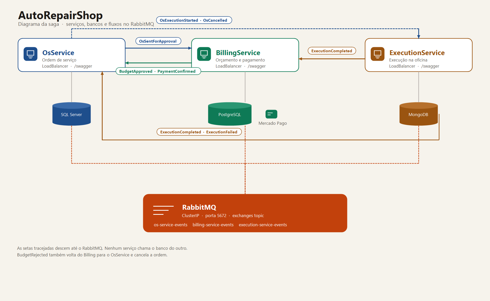

# AutoRepairShop — OsService

Microsserviço responsável pelo ciclo de vida das **Ordens de Serviço (OS)**.  
Parte da arquitetura distribuída do **Tech Challenge Fase 4 · 12SOAT**.

## Arquitetura



Os três serviços ficam no namespace `autorepair`. Cada API tem LoadBalancer e Swagger. O RabbitMQ continua `ClusterIP`: os pods publicam e consomem na porta 5672.

```
src/
├── OsService.Api            → Controllers REST, Swagger, Program.cs
├── OsService.Application    → Application Services, DTOs, Event Handlers (Saga consumers)
├── OsService.Domain         → Entidades, Enums, Domain Events, Interfaces
└── OsService.Infrastructure → EF Core (SQL Server), RabbitMQ Publisher, Repository
tests/
└── OsService.Tests
    ├── Unit/                → Testes unitários do domínio (xUnit + FluentAssertions)
    └── BDD/                 → Cenários Gherkin da saga (Reqnroll)
k8s/                         → Manifestos Kubernetes (Deployment, Service, HPA, ConfigMap)
.github/workflows/ci.yml     → Pipeline CI/CD (Build → Testes → SonarQube → Docker → K8s)
```

## Banco de dados

**SQL Server 2022** — banco próprio e isolado. Nenhum outro serviço acessa este banco diretamente.

## Fluxo de Status da OS

```
Received → InDiagnosis → WaitingApproval → InExecution → Finished → Delivered
                                                                          ↑
                                                               (qualquer estado) → Canceled
```

## Saga Pattern — Coreografado

### Eventos publicados (RabbitMQ · exchange: `os-service-events`)

| Evento | Quando | Consumidor |
|---|---|---|
| `OsSentForApprovalEvent` | Diagnóstico ok + itens + send-for-approval | BillingService (cria e popula o Budget) |
| `OsExecutionStartedEvent` | Após aprovação do orçamento | ExecutionService |
| `OsCancelledEvent` | OS cancelada | BillingService, ExecutionService |

Criar a OS, incluir item, iniciar diagnóstico, finalizar e entregar não publicam evento. Finalizar e entregar acontecem só pelos eventos da saga.

### Eventos consumidos

| Evento | Origem | Ação |
|---|---|---|
| `BudgetApproved` | BillingService | Inicia a execução e publica `OsExecutionStartedEvent` |
| `ExecutionCompleted` | ExecutionService | Finaliza a OS (`Finish`) |
| `PaymentConfirmed` | BillingService | Entrega a OS (`Deliver`) |
| `BudgetRejected` | BillingService | Cancela a OS (compensação) |

## Endpoints REST

| Método | Rota | Descrição |
|---|---|---|
| `POST` | `/api/serviceorder` | Cria nova OS |
| `GET` | `/api/serviceorder/{id}` | Busca OS por ID |
| `GET` | `/api/serviceorder?status=X` | Lista por status |
| `POST` | `/api/serviceorder/{id}/items` | Adiciona item durante o diagnóstico |
| `PATCH` | `/api/serviceorder/{id}/start-diagnosis` | Inicia diagnóstico |
| `PATCH` | `/api/serviceorder/{id}/send-for-approval` | Envia para aprovação |
| `PATCH` | `/api/serviceorder/{id}/cancel` | Cancela OS |
| `GET` | `/health` | Health check |

Swagger disponível em: `http://localhost:5010/swagger`

## Executando com Docker

```bash
# Copie e configure as variáveis
cp .env.example .env

# Suba tudo (API + SQL Server + RabbitMQ)
docker compose up -d

# Migrations (aplicadas automaticamente no startup)
# Para rodar manualmente:
dotnet ef database update --project src/OsService.Infrastructure --startup-project src/OsService.Api
```

## Testes

```bash
# Rodar todos os testes
dotnet test

# Com cobertura
dotnet test --collect:"XPlat Code Coverage"
```

Cobertura mínima exigida pelo pipeline: **80%** de linhas. Abaixo disso o job `Build, Test & Quality` falha.

Medição local em 5 de novembro de 2026, configuração Release, relatório OpenCover do Coverlet:

| Testes | Linhas cobertas | Cobertura de linhas |
|---|---|---|
| 45 aprovados | 324 / 353 | **91,8%** |

### BDD (Gherkin)

Os cenários ficam em `tests/OsService.Tests/BDD/SagaDaOrdem.feature`, escritos em português (`# language: pt`). O Reqnroll (sucessor do SpecFlow) transforma cada `Cenário` em teste xUnit e liga os passos à classe `SagaDaOrdemSteps`. A execução é em memória: repositório e publicador de eventos são falsos, sem SQL Server nem RabbitMQ.

| Cenário | O que confere |
|---|---|
| Caminho feliz até a entrega do veículo | `WaitingApproval`, `InExecution`, `Finished` e `Delivered`, com `OsSentForApprovalEvent` e `OsExecutionStartedEvent` |
| Cliente recusa o orçamento e a ordem é cancelada | `Canceled` |
| Falha na oficina cancela a ordem e avisa a saga | `Canceled` e `OsCancelledEvent` |

```powershell
dotnet test tests/OsService.Tests/OsService.Tests.csproj --filter FullyQualifiedName~BDD
```

### SonarQube

O mesmo job envia a análise para o SonarCloud (`sonar-project.properties`, chave `AutoRepairOrg_AutoRepairShop-OsService`).

[](https://sonarcloud.io/summary/overall?id=AutoRepairOrg_AutoRepairShop-OsService)

Consulta pública da API em 5 de novembro de 2026:

| Métrica | Resultado |
|---|---|
| Quality Gate | Aprovado (`OK`) |
| Bugs | 0 |
| Vulnerabilidades | 0 |
| Code smells | 0 |
| Confiabilidade, segurança e manutenibilidade | A |
| Linhas duplicadas | 0% |

Painel: [sonarcloud.io/summary/overall?id=AutoRepairOrg_AutoRepairShop-OsService](https://sonarcloud.io/summary/overall?id=AutoRepairOrg_AutoRepairShop-OsService)

## Observabilidade (Datadog)

Logs, traces e métricas saem quando `DD_API_KEY` está definida. Sem a chave o serviço sobe e o log fica no console.

No cluster, crie o secret uma vez no namespace `autorepair` (os três deployments leem o mesmo):

```bash
kubectl -n autorepair create secret generic datadog-secret --from-literal=api-key=SUA_API_KEY
```

O modelo está em `k8s/datadog-secret.example.yaml`. O valor `SUBSTITUA_PELA_API_KEY` não é enviado. Se a organização for da Europa, troque `DD_SITE` no deployment de `datadoghq.com` para `datadoghq.eu`.

Na máquina local:

```powershell
$env:DD_API_KEY = "SUA_API_KEY"
$env:DD_SITE = "datadoghq.com"
```

O `docker compose` repassa essas variáveis. O serviço deste repositório publica como `os-service`.

No Datadog, Logs → Explorer: `service:os-service`. A saga aparece com `event_type` e `correlation_id`. APM → Traces mostra o span `saga publish` deste serviço como pai do `saga consume` do próximo. Métricas: `autorepair.saga.published`, `autorepair.saga.consumed`, `autorepair.saga.failed`, `autorepair.http.requests`, `autorepair.http.duration`.

O painel para importar está em `observability/datadog-dashboard.json` (Dashboards → New Dashboard → Import dashboard JSON). O passo a passo dos três serviços está em `guia-observabilidade-datadog.md` na pasta da fase.

## Tech Stack

- .NET 8 / ASP.NET Core
- Entity Framework Core + SQL Server 2022
- RabbitMQ (mensageria — Saga coreografado)
- xUnit + FluentAssertions + Moq (testes unitários)
- Reqnroll + Gherkin (BDD)
- Docker + Kubernetes (Minikube / produção)
- GitHub Actions (CI/CD)
- SonarQube (qualidade de código)
- OpenTelemetry + Serilog (logs, traces e métricas no Datadog)

## Autores

Projeto desenvolvido por **Dhiulia da Silva** e **Mateus Pinheiro** · 12SOAT Fase 4
